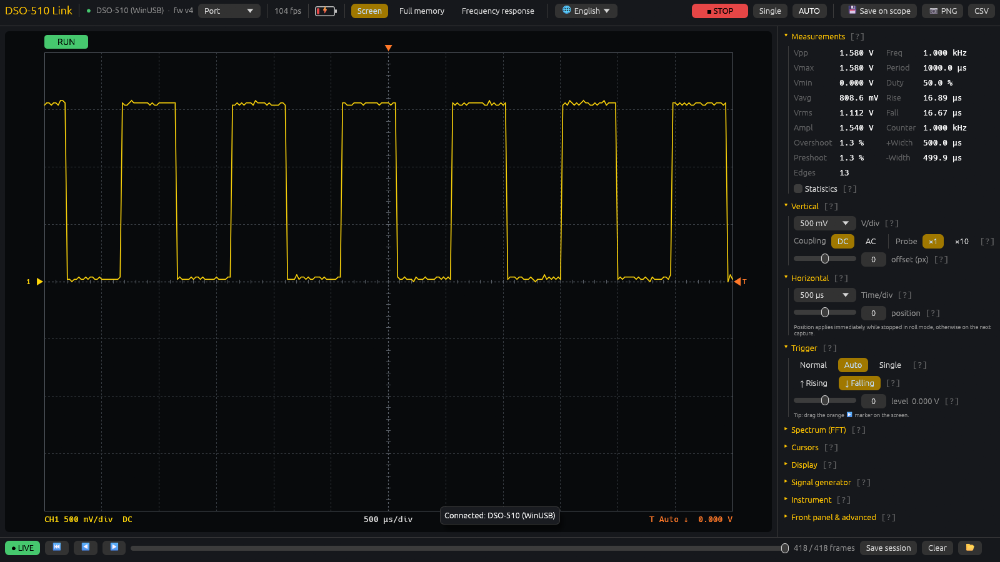
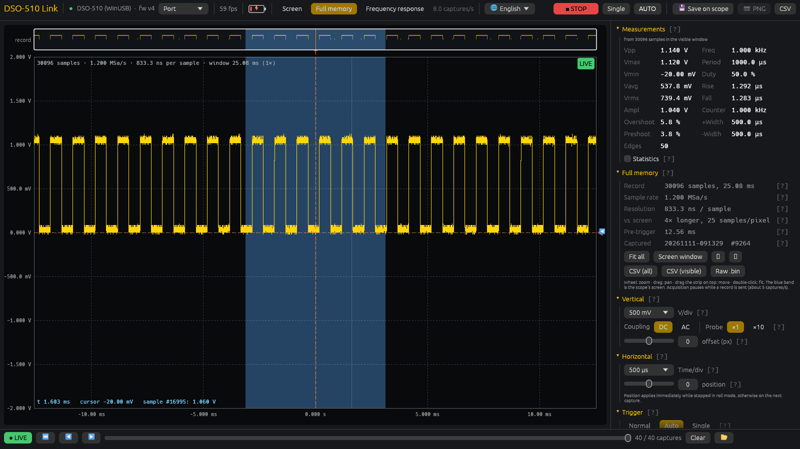
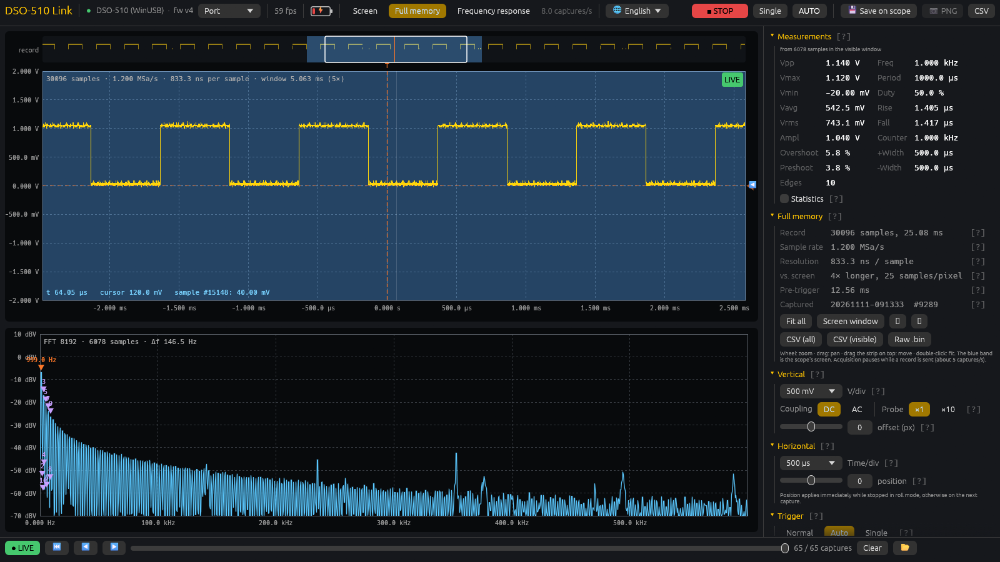
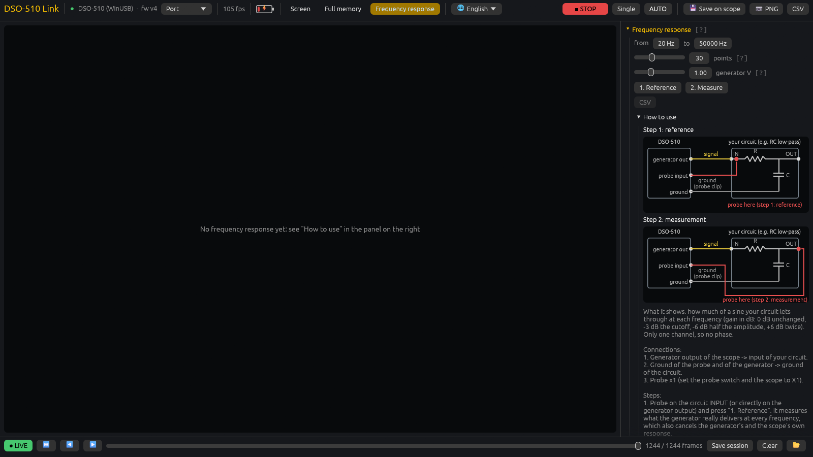
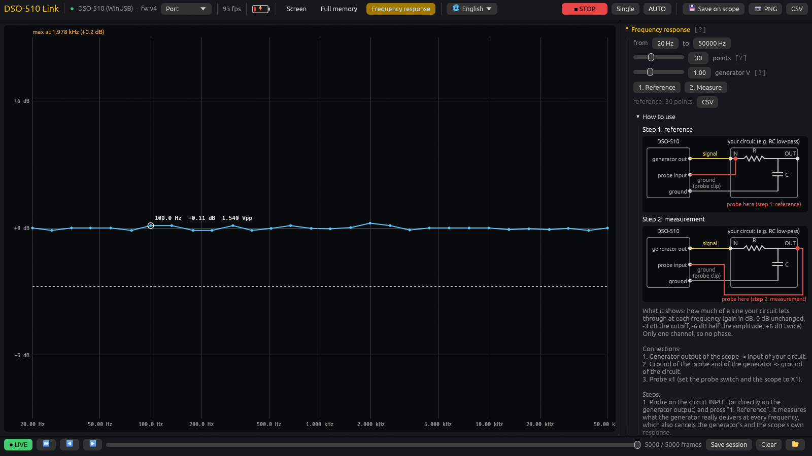
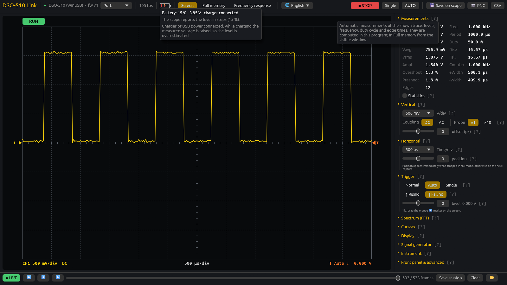

# DSO-510 community firmware and PC application

Improved firmware for the **DSO-510** handheld oscilloscope and **DSO-510 Link**, a Windows application that shows and
controls the scope over USB. See [CHANGELOG.md](CHANGELOG.md) for everything that changed.

| Path | Content |
|---|---|
| `firmware/APP_DSO-510_v4.20.bin` | firmware image (based on the original APP V2.0.5 250114) |
| `bin/DSO-510-Link.exe` | PC application, ready to run (Windows 10/11, x64) |
| `bin/DSO-510-Calibrate.exe` | calibration of the voltage readings with a known DC voltage |
| `app/` | source code of the PC application (Rust) |
| `SHA256SUMS` | checksums of both binaries |

## Screenshots

**Screen**: the live trace with measurements and all scope settings.



**Full memory**: every one of the 30100 samples of each acquisition, with zoom and pan; the strip on top shows
the whole record and the blue band the part the scope shows.



**FFT** of the full record, with the harmonics marked.



**Frequency response**: a Bode magnitude plot made with the scope's own generator. Instructions and connection
diagrams are in the panel.





**Help tips**: the battery icon and every `[?]` explain themselves when the mouse rests on them.



## Flashing the firmware
1. Switch the scope off. Hold the update button while switching it on: the scope appears as the USB drive
   **"AT32 MSC IAP"** (the bootloader, not changed by this firmware).
2. Copy `firmware/APP_DSO-510_v4.20.bin` to that drive and wait until the scope restarts.
3. Going back to the original firmware works the same way with the original image.

The firmware is a full image: the original firmware with patches. It only works on the DSO-510 with the AT32F403A.

## Using the PC application
1. Connect the scope with a USB cable (data cable). With this firmware it appears as a WinUSB device, no driver needed.
2. Start `bin/DSO-510-Link.exe`; it finds the scope by itself.
3. Views in the top bar: **Screen** (live trace), **Full memory** (every sample of each acquisition),
   **Frequency response** (Bode plot with the built-in generator; instructions and connection diagrams in the panel
   on the right under "How to use").
4. Language: menu 🌐 (Polish, English). Exports go to `Documents\DSO-510`.
5. **Noise reject** (Trigger section, firmware v4.19): trigger hysteresis like a bench scope. Noise riding on the
   signal no longer moves the trigger point, so the picture stops jumping. The level must then be at least 0.4 div
   inside the signal's swing.
6. **Time selection** in Full memory: drag with the right mouse button over the plot, or with the left button along
   the time axis. The selection shows Δt and 1/Δt; measurements, FFT and "CSV (visible)" use only the selected
   samples. Double-click inside it to zoom to it; right click or Esc removes it.
7. **Start-up picture** (firmware v4.20): section "Start-up picture" in the side panel. Choose any image (PNG, JPG,
   BMP, GIF) or drop it on the window; it is fitted to the 320 × 240 screen ("Fill the screen" crops, "Whole
   picture" adds black bars), shown as the scope will show it and uploaded over the USB cable in about a second.
   At the next start it fades in from black like the factory logo. "Factory logo" brings the original animation
   back.

## Calibrating the voltage readings
The scope keeps one vertical scale factor in its settings, shared by all V/div ranges. The original firmware sets it
by itself the first time AUTO is pressed while the settings are empty, from whatever is on the screen at that moment,
so it can be wrong; then every voltage is shown too large or too small by the same factor (seen on one unit: 1.5x
too large).

**Check first:** measure a voltage you know (a battery, 3.3 V or 5 V, checked with a multimeter) with DC coupling and
the probe at x1. If the scope shows it within a few percent, nothing needs to be done.

**To calibrate** start `bin/DSO-510-Calibrate.exe` (close DSO-510 Link first: only one program can use the scope):
1. Set the switch on the probe to x1 and enter the voltage you measured with the multimeter. Best between 1 and 10 V,
   any DC source; not the scope's own generator.
2. Optional, more accurate: clip the probe tip to its own ground clip and press **1. Measure zero**.
3. Probe tip on the plus, ground clip on the minus, press **2. Measure the voltage**. The program sets the scope by
   itself (DC, x1, Auto, every V/div range where the voltage fits) and restores your settings afterwards.
4. Check the table (what the ADC measures, what the screen showed, what it will show) and press **Apply**. The
   program writes the new factor and reads the screen again.
5. **Switch the scope off with its power button**: only then the factor is saved in its settings.

"Restore the value read at start" and "Set factor 1.0" undo it (then switch off with the button again). The program
shows the instructions as well, in English and Polish, and warns about the usual mistakes (probe switch at x10,
no contact, a changing signal instead of a DC voltage).

## Start-up picture: notes
- The picture is stored as `BOOTLOGO.JPG` in the root of the scope's 5 MB picture drive (2:); at start the
  firmware looks for it first, then for the original `2:/LOGO/LOGODSO-510.jpg`.
- If the upload ends with "storage full or damaged": on some units this drive is full of lost data and its folders
  are unusable (the scope's own screenshot gallery does not work either). The application then offers
  **Repair the drive (quick format)**: it empties the drive's file tables and creates its folders again (the
  original firmware has no working format). The drive with the scope's interface graphics (3:) is not touched.

## Building the application
```
cd app
cargo build --release        # target\release\dso510-link.exe and dso510-calibrate.exe
cargo test --release         # unit tests and UI tests
```
Requires Rust (edition 2024). The `examples/` folder holds the device test tools used during development (profiling,
trigger tests, measurement matrix, frequency response test); they talk to a connected scope.

## Notes
- New diagnostic commands of the firmware (`PROF`, `PROFD`, `TRIGTEST`, `THYST`, `LOGO`, `FASTBUILD`, `FREQHW`, `BATT`, `PEEK`, ...)
  are text lines sent over the USB link. The application offers INFO / DIAG / GET under "Front panel & advanced";
  the tools in `app/examples/` (e.g. `prof`, `trigtest`, `freqhw`) send the others.
- Use at your own risk. The bootloader is untouched, so the original firmware can always be restored.
